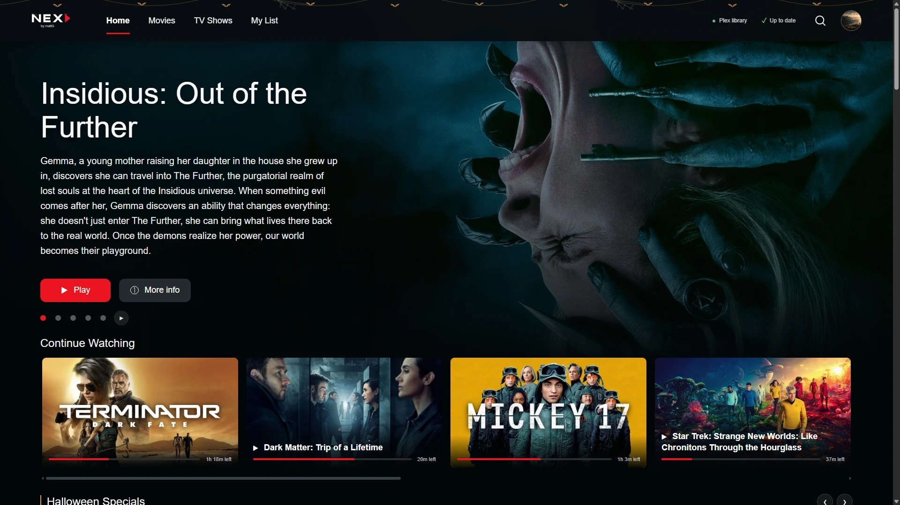
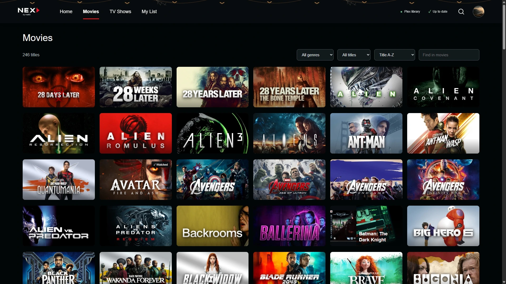
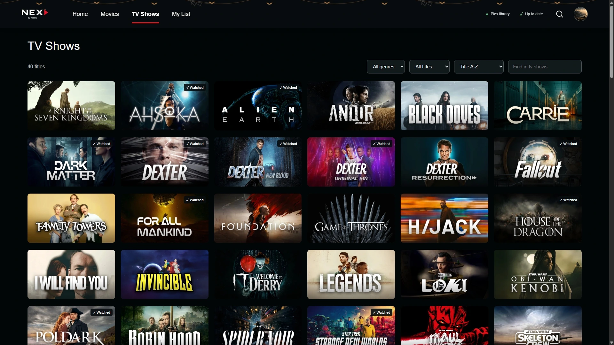

<div align="center">
  <a href="https://nex.mattgtv.co.uk/">
    
  </a>

# Your home cinema.

**Your movies. Your shows. A cinematic new way to watch.**

Nex brings your own movie and TV library to Windows, Android TV and the web,\
with artwork that takes centre stage and an interface built around watching.

**[Explore Nex](https://nex.mattgtv.co.uk/) · [Download](#download-nex) · [Get started](#get-started) · [FAQ](#frequently-asked-questions) · [Get help](#help-and-feedback)**

[](https://nex.mattgtv.co.uk/windows)
[](https://nex.mattgtv.co.uk/android)
[](https://nex.mattgtv.co.uk/web-client)

</div>

[](https://nex.mattgtv.co.uk/)

<p align="center"><em>The real Nex interface. Your library supplies the stories; Nex sets the scene.</em></p>

## Meet Nex

Rediscover the films you love, pick up an episode where you left off, and find something for tonight without leaving your own library. Nex combines a cinematic Home screen, original title artwork, detailed movie pages and familiar playback controls across three clients.

**Nex is a viewing client for your existing media server.** Plex or Jellyfin continues to manage your media, accounts and library permissions. Nex does not include films or television programmes, and the Nex website is a showcase rather than a public streaming service.

This repository is the official home for **Nex downloads, release notes and user guidance**. Application development source is not hosted here.

## Download Nex

Choose the client for the device you watch on. These links always point to the current public package; the [release history](https://github.com/mattGUK97/nex-releases/releases) keeps earlier downloads and their notes.

| Client | Download | What you need | Media servers |
| :--- | :--- | :--- | :--- |
| **Windows** | **[Download Windows installer (.exe)](https://nex.mattgtv.co.uk/windows)** | Windows 10 or 11, Intel/AMD x64 | Plex · Jellyfin |
| **Android TV / Google TV** | **[Download Android TV APK](https://nex.mattgtv.co.uk/apk)** | Android 6.0 or later; TV remote | Plex · Jellyfin |
| **Web Client** | **[Download Web Client (.zip)](https://nex.mattgtv.co.uk/web-client/download)** | A host with Node.js 22+ or Docker Compose; a compatible viewing browser | Plex |

The public packages are test releases under active development. Hardware decoding, HDR, audio passthrough and format compatibility depend on your device, server and network. For platform details, visit the [website compatibility guide](https://nex.mattgtv.co.uk/compatibility.html).

> **Want to watch in your browser?** If your household already runs Nex, open its Nex server address. Otherwise, install the Web Client once on your own computer, NAS or server using the steps below. There is no separate installation on every browser device.

## Made for movie night

| Discover | Watch | Make it yours |
| :--- | :--- | :--- |
| **Cinematic Home** with rotating features ordered by movie release date | **Continue Watching** with resume and server watch progress | **Existing profiles**, including supported Plex Home PIN checks |
| **Artwork-led browsing** with title logos, Movies, TV Shows and genre shelves | **Native playback** on Windows and Android TV | **My List** for films and shows to come back to |
| **Search** across your accessible library | **Audio, subtitles and quality controls** | **Profile preferences** for your viewing experience |
| **More Info** with synopsis, cast portraits, credits and source-labelled ratings when available | **Timeline previews, chapters and skip controls** when supported and supplied | **Seasonal themes and selections**, with a per-profile switch |
| **Watch Trailer** beside Play/Resume when a suitable trailer is found | **Episode autoplay** with an inactivity check | **Update checks** and clear version status |

### A closer look

<table>
  <tr>
    <td width="50%" align="center"><strong>Movies</strong><br><br><a href="docs/images/nex-movies.webp"></a></td>
    <td width="50%" align="center"><strong>TV Shows</strong><br><br><a href="docs/images/nex-shows.webp"></a></td>
  </tr>
</table>

These are captures of Nex, rather than invented interface mockups. Profile photos have been replaced for privacy. Artwork, viewing progress, metadata and seasonal decoration depend on your library, profile and date. Select a screenshot to see it at full size.

## Choose your experience

| Capability | Windows | Android TV / Google TV | Web Client |
| :--- | :--- | :--- | :--- |
| Plex movies, shows and existing profiles | Yes | Yes | Yes |
| Jellyfin movies, shows and users | Yes | Yes | — |
| Cinematic Home, complete catalogues, genres and search | Yes | Yes | Yes |
| Resume, watched status and My List | Yes | Yes | Yes |
| Cast portraits, credits and available ratings | Yes | Yes | Yes |
| Trailers when available | Yes | Yes | Yes |
| Playback engine | Native mpv | Native Android Media3 | Browser video / Plex conversion |
| Audio, subtitles, quality and playback speed | Yes | Yes | Yes |
| Timeline thumbnail previews | Yes | Yes | Yes |
| Chapters and intro/credit skipping | When supplied | When supplied | When supplied |
| Subtitle search and SRT/VTT upload | Provider-dependent | Provider-dependent | Provider-dependent |
| Queue and next-episode playback | Yes | Yes | Yes |
| Update checks | Prompt and installer download | Download and installation progress | Prompt and host-package download |

Support varies by media server and client. A feature can only use tracks, chapters, markers, ratings or extras that are available to the selected account. My List and queue behaviour are described in the FAQs below.

## Get started

### Windows

1. [Download the Windows installer](https://nex.mattgtv.co.uk/windows) and install Nex.
2. Open Nex and choose **Plex** or **Jellyfin**.
3. Enter your media server address. Sign in to Plex using its normal authorization flow, or use your Jellyfin account credentials.
4. Choose your profile, enter its PIN or password if required, and open your library.

The Windows client uses a native player. On the first connection, it retrieves its verified playback component from the official mpv project; that component is then cached for reuse. Current Windows installers are not Authenticode-signed.

### Android TV / Google TV

1. On your TV, use a browser or downloader app to open **[nex.mattgtv.co.uk/apk](https://nex.mattgtv.co.uk/apk)**, then install the APK. Android may ask you to allow that app to install it.
2. Open Nex, choose **Plex** or **Jellyfin**, and select **Find server** or enter your server address. Protocol and port fields have editable defaults.
3. For Plex, follow the displayed instructions to enter the linking code at **[plex.tv/link](https://plex.tv/link)** on your phone or computer. For Jellyfin, sign in with your server account.
4. Choose your profile and start watching. Move across the top tabs with the remote to switch sections; press **Down** to enter the content.

Nex is designed for a television and remote. This APK is sideloaded; it is not a Google Play Store listing. The TV must be able to reach your chosen media server.

### Web Client — set up once, watch in your browser

1. [Download the Web Client ZIP](https://nex.mattgtv.co.uk/web-client/download) and extract it into a folder on the computer, NAS or server that will host Nex.
2. Copy the included blank `.env.example` to `.env`. Set **your own** `PLEX_URL` and `PLEX_TOKEN` using the package instructions and [Plex's token guide](https://support.plex.tv/articles/204059436-finding-an-authentication-token-x-plex-token/). Keep that file private.
3. Start Nex using **one** of the methods below.

**Docker Compose** — run inside the extracted folder:

```sh
docker compose up -d --build
```

**Node.js 22 or later** — run inside the extracted folder:

```sh
npm ci --omit=dev
npm start
```

4. Open **http://localhost:3080** on that host, or **http://your-server:3080** from another device on your network. Replace `your-server` with your host's name or address.
5. Choose your Plex profile. Share the Nex browser address with your household, rather than installing the ZIP on every viewing device.

Without Plex configuration, the Web Client can display a clearly labelled fictional preview library; those preview titles are not playable films. The [Web Client guide](https://nex.mattgtv.co.uk/web-client) explains hosting in more detail.

## Staying up to date

**Windows and Web** check for updates on launch and show **Up to date** or **Update available** beside the library indicator. An available update offers a download, **Skip**, or **Remind me later**. Reminders wait until you are out of playback.

- **Windows:** run the newer installer over your existing installation.
- **Web:** update the Nex host, not each browser. Back up and retain your `.env`, data and Docker volume, then restart Node or rebuild/recreate the container using the new package. Do not replace your private configuration with the blank template.
- **Android TV:** automatic updates are enabled by default. Use **App updates** to change that setting or check now. Newer clients show download percentage, downloaded/total MB and recent speed, followed by verification and installation stages. You can hide and reopen progress without cancelling the download. Installation waits until you are outside playback; Android may request confirmation and briefly close Nex while replacing it. Reopen Nex when finished. **Update over the existing app; do not uninstall first.**

Downloads are hosted in this repository's [GitHub Releases](https://github.com/mattGUK97/nex-releases/releases). Each release includes checksums; the website's [release manifest](https://nex.mattgtv.co.uk/releases.json) records the current packages. Android verifies its downloaded APK's size, SHA-256 and Nex signing certificate before installation.

## Frequently asked questions

<details>
<summary><strong>Does Nex replace my Plex or Jellyfin server?</strong></summary>

No. Nex is the viewing interface. Your server still stores and indexes your media, supplies metadata, enforces account permissions and performs any required conversion. Keep the server running and use its own tools for library administration.

</details>

<details>
<summary><strong>Does Nex include movies or give me access to streaming subscriptions?</strong></summary>

No. Connect your own library and use media you are entitled to access. Screenshots demonstrate the interface; downloading Nex does not include the titles pictured or access to Netflix, Prime Video, Disney+ or other services.

</details>

<details>
<summary><strong>Which client should I install?</strong></summary>

Choose Windows for a Windows PC, the APK for an Android TV or Google TV, and the Web Client if you want to host Nex once and watch from browsers. The current Web Client supports Plex. Windows and Android TV also support Jellyfin. There are no dedicated Nex iOS, macOS, Roku or Apple TV packages in this repository.

</details>

<details>
<summary><strong>Will my existing profiles and watch progress work?</strong></summary>

Nex uses the profiles and library access available through your chosen server account. Protected profiles retain their server-side checks. Playback progress and watched/unwatched changes are reported to that server using the selected user, so other compatible clients can pick up those changes. Your server must be reachable for synchronization.

</details>

<details>
<summary><strong>Is My List the same as Plex Watchlist?</strong></summary>

No. Plex-backed Nex My List is stored by Nex per profile and does not synchronize with Plex Discover Watchlist. Separate Nex installations do not automatically share that local list. In the native Jellyfin clients, My List uses Jellyfin favourites. Nex's play queue is also its own client workflow, rather than Plex's server play-queue system.

</details>

<details>
<summary><strong>Can I watch 4K, HDR or surround sound?</strong></summary>

Nex can request original media, but successful playback depends on the file's codec, bitrate, subtitle format, your network and the viewing device's decoder/audio capabilities. Native Windows and Android TV playback differs from browser playback. Server conversion is available for compatible fallback or lower quality settings. Nex does not guarantee every 4K/HDR/audio format on every device.

</details>

<details>
<summary><strong>Why is Watch Trailer missing on a title?</strong></summary>

Nex shows Watch Trailer when it finds a suitable source. Plex clients check available online extras and can use Plex Discover for the matching movie or show when the local server has no trailer. This reuses your existing Plex sign-in. Availability depends on the title and source; Nex cannot promise a trailer for every item. It selects the highest MP4 quality the source offers. Trailer playback does not change the film's watch progress.

</details>

<details>
<summary><strong>Why do some titles have no ratings or cast photo?</strong></summary>

Nex displays metadata that can be resolved from supported sources. IMDb, Rotten Tomatoes and TMDb labels identify the relevant rating source; missing scores are not invented. Coverage varies, and optional extra metadata configuration may be needed. Missing portraits can fall back to initials while the rest of the title page remains usable.

</details>

<details>
<summary><strong>What is the difference between English (CC) and English (Forced)?</strong></summary>

On Android TV, the simplified subtitle menu groups English tracks into full captions and forced subtitles. **English (CC)** is the full-dialogue option; sound descriptions depend on the actual track. **English (Forced)** is intended for foreign-language dialogue or signs only. It appears only when a real forced track is available. **Off** is the default, and a missing forced track never silently substitutes full captions.

Nex cannot generate a missing forced translation. Your server must have the correct embedded or external subtitle file and identify it correctly. Web and Windows retain their own track menus.

</details>

<details>
<summary><strong>Why are Skip Intro, Skip Credits or chapters missing?</strong></summary>

These controls depend on markers and chapter times supplied by your media server. They do not appear for every file. Plex's own marker generation, configuration and account requirements still apply; Nex does not bypass them.

</details>

<details>
<summary><strong>Can I search for or upload subtitles?</strong></summary>

The current clients include subtitle search and SRT/VTT upload workflows where the provider and account permissions allow them. Search results, downloads and upload availability depend on your server and its subtitle provider. This is separate from automatic subtitle acquisition by tools such as Bazarr.

</details>

<details>
<summary><strong>Why do the featured banner and Recently Added show different films?</strong></summary>

The rotating movie banner prioritizes the latest movie release dates available in your library. Recently Added follows when items were imported into the server. Adding an older film therefore does not make it a new theatrical release. Home also includes Continue Watching and available seasonal/genre selections; full catalogues remain under Movies and TV Shows.

</details>

<details>
<summary><strong>Can I use Nex away from home?</strong></summary>

Only when the viewing device can securely reach the required server. For the self-hosted Web Client, configure your own HTTPS access and authentication rather than exposing an unprotected local service. Nex does not configure your router or provide a hosted relay. Server permissions and remote connectivity remain your responsibility.

</details>

<details>
<summary><strong>What information does Nex store?</strong></summary>

The native clients store connection details and per-profile preferences locally. Windows protects tokens with DPAPI; Android uses Android Keystore encryption. Profile PINs and account passwords are not saved by the native clients. The Web Client host keeps its connection in your private configuration and its own application data. No developer credentials, private server addresses or household configuration are included in the downloads.

Nex still contacts the services needed for the features you use: your media server, applicable account/metadata/trailer services, the update manifest and download hosts. This is not an offline-only application.

</details>

<details>
<summary><strong>Is Nex open source?</strong></summary>

This is a public distribution and documentation repository, not the application's development repository. Its visibility should not be taken as an open-source licence for Nex. Third-party components retain their own licences and notices, which are supplied with the relevant package or playback component.

</details>

<details>
<summary><strong>Which Plex features are not included?</strong></summary>

Nex focuses on watching your own films and television. Offline downloads, casting/remote player control, Watch Together, full playlist management and multiple file editions/versions are not currently complete Nex features. Music, photos and Live TV/DVR are outside the current movie/TV experience. Manage server settings, library edits, account administration and provider subscriptions in Plex or Jellyfin.

</details>

## Help and feedback

Found a bug or have an idea? **[Open an issue](https://github.com/mattGUK97/nex-releases/issues/new/choose)**, or browse [existing reports](https://github.com/mattGUK97/nex-releases/issues) first.

For a useful bug report, include:

- The client, version and build shown in Nex, plus your device and OS version.
- Whether you use Plex or Jellyfin and the server version, if known.
- What you expected, what happened, and clear steps to reproduce it.
- A screenshot or short recording where useful. For playback issues, include the media's codec/resolution and whether you used Original or conversion.

Remove account tokens, passwords, PINs, private server addresses and personal information before posting screenshots or logs. GitHub issues are public. For feature ideas, explain the viewing problem you want to solve and which client it affects. Code contributions cannot be built from this release-only repository.

## Project links

- **[Nex website](https://nex.mattgtv.co.uk/)** — the app, screenshots and platform information.
- **[All releases](https://github.com/mattGUK97/nex-releases/releases)** — packages, release notes and checksums.
- **[Windows download](https://nex.mattgtv.co.uk/windows)** · **[Android TV APK](https://nex.mattgtv.co.uk/apk)** · **[Web Client guide](https://nex.mattgtv.co.uk/web-client)**.
- **[Compatibility guide](https://nex.mattgtv.co.uk/compatibility.html)** · **[Artwork credits](https://nex.mattgtv.co.uk/artwork)**.

---

<p align="center"><strong>Nex — by mattG</strong><br>Your library. Your home cinema.</p>

Nex is an independent client and is not affiliated with or endorsed by Plex or Jellyfin. Movie and television artwork, titles and third-party marks belong to their respective owners.
